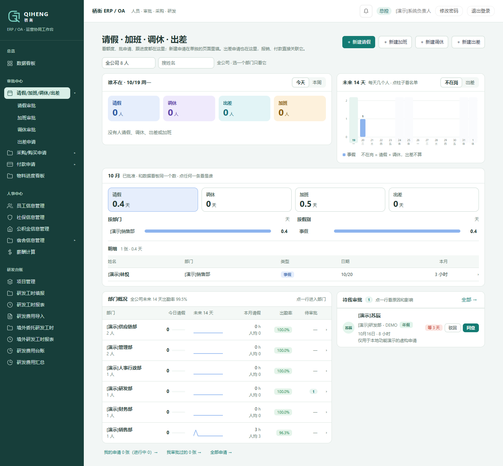
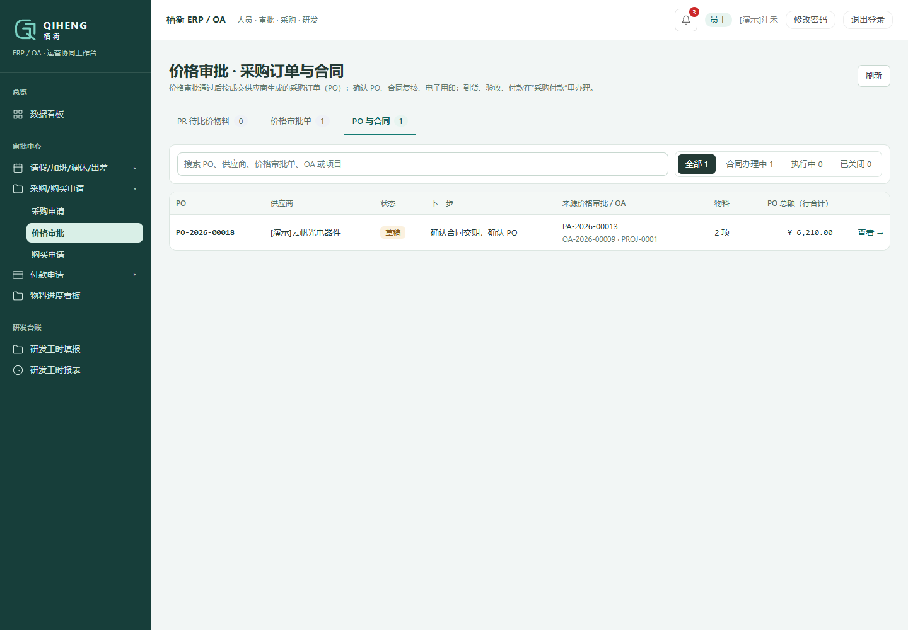

# 栖衡 ERP / OA · QIHENG · 企业运营与协同管理


> 数据说明：业务样例采用脱敏或合成数据，真实部署凭据通过环境变量或站点私有配置提供。详见 [数据与凭据](SECURITY.md)。
围绕企业的人员、审批、采购和研发成本管理，将员工申请、管理审批、采购执行与工时记录连接起来，支持员工、主管、人事、采购及财务按角色协作。

**Vue 3 · Frappe / ERPNext / HRMS 15 · Python · MariaDB · Docker**

[功能概览](#功能概览) · [界面预览](#界面预览) · [运行项目](#运行项目) · [演示数据](#演示数据) · [工程实现](#工程实现)

## 功能概览

| 模块 | 核心功能 |
| --- | --- |
| 员工与组织 | 公司、部门、员工档案、岗位与角色管理 |
| 考勤与审批 | 请假、加班、调休、出差，假期额度、部门概况与待办审批 |
| 采购协作 | OA 申请、采购需求 PR、供应商比价、价格审批、采购订单 PO 与合同衔接 |
| 付款与物料 | 付款申请、采购执行与物料进度查看 |
| 研发管理 | 研发项目、工时填报、工时报表、费用导入、分摊与台账 |
| 人事配套 | 薪酬、社保、公积金及宿舍管理 |

**采购业务链：** 员工 OA 申请 → 岗位审批 → PR → 比价 / 价格审批 → PO → 合同、到货、验收与付款。

## 界面预览

采用虚构品牌 **栖衡 QIHENG**，深青色导航与浅色 ERP / OA 工作台，统一导航、表格、按钮、登录页与浏览器图标。

### 考勤与审批总览

查看人员动态、部门统计、假期分布和待办申请，在同一页面了解团队状态并处理审批。



<details>
<summary><strong>采购订单与合同工作台：查看界面</strong></summary>

从采购订单追溯来源申请、价格审批、供应商与物料，查看金额及下一步操作。



</details>

截图来自已初始化的本地环境（2026-10-19），业务记录使用「演示」标识。页面内容随角色权限变化。

## 运行项目

准备 **Windows PowerShell、Git、Python**，并确认 Docker Desktop 的 **Linux 引擎**正常运行：

```powershell
git clone https://github.com/Meteor7/erp-oa-system.git
cd erp-oa-system
git config core.hooksPath .githooks
docker info
```

先按 [创建本地凭据](deploy/LOCAL-DEPLOYMENT.md#create-local-credentials-first-clone-only) 生成 `.local/logistics.env`，再执行：

```powershell
powershell -NoProfile -ExecutionPolicy Bypass -File .\scripts\deploy-to-docker.ps1 -InitializeLocal -DryRun
# 检查成功后启动初始化
powershell -NoProfile -ExecutionPolicy Bypass -File .\scripts\deploy-to-docker.ps1 -InitializeLocal
```

初始化会安装 Frappe、ERPNext、HRMS 与项目应用，创建 `logistics.localhost` 站点，并在 Docker 内安装前端依赖和构建。

| 入口 | 地址 / 说明 |
| --- | --- |
| 业务工作台 | [http://127.0.0.1:8082/planck-semicon](http://127.0.0.1:8082/planck-semicon) |
| 管理后台 | [http://127.0.0.1:8082/app](http://127.0.0.1:8082/app) |
| 管理员 | `Administrator`；密码为本地配置中的 `LOCAL_ADMIN_PASSWORD` |

这些地址用于运行项目的本机。新站点需要配置公司、员工和审批岗位，也可导入演示数据。完整步骤见 [部署文档](deploy/LOCAL-DEPLOYMENT.md)。可选的 [发票 OCR 服务](docs/invoice-ocr-runbook.md) 需要单独部署。

## 演示数据

[小规模演示脚本](rayher_hr_payroll/maintenance/local_demo.py) 包含 **8 名员工、2 个研发项目、3 种物料、2 家供应商**，以及考勤、工时、7 张 OA 申请和一条 **PR → 价格审批 → PO** 的采购示例。

在 `logistics.localhost` 的 Bench Console 中按顺序调用：

| 步骤 | 函数 | 用途 |
| --- | --- | --- |
| 1 | `seed_masters(confirm=..., password=...)` | 公司、员工、角色和基础资料；为新账号指定至少 20 字符密码 |
| 2 | `seed_activity(confirm=...)` | 考勤、工时、请假、加班与购买申请 |
| 3 | `seed_procurement(confirm=...)` | 采购申请、PR、价格审批和 PO |

`confirm` 必须为 `"logistics.localhost"`。日期根据执行时间生成；脚本不会重置已有用户密码。业务数据保存在本地数据库。

推荐演示顺序：**员工申请 → 主管审批 → 考勤总览 → 采购与比价 → PO → 研发工时**。可使用 `demo.engineer1@example.com`、`demo.manager@example.com`、`demo.buyer@example.com` 等演示账号体验不同角色。

## 工程实现

- **跨角色业务协作：** 通过员工、岗位、审批配置与单据关联组织业务流程。
- **业务数据集中管理：** 基于 Frappe、ERPNext 与 HRMS，实现人员、采购和研发管理的统一工作台。
- **部署可追溯：** 本地源码提交后通过 Git bundle 进入 Docker，由部署脚本完成构建和更新。

本作品集仓库不配置自动部署（CD）。更新现有环境采用 **本地修改 → Git 提交 → 部署检查 → 按需部署**，详见 [更新步骤](deploy/LOCAL-DEPLOYMENT.md#subsequent-deployment-and-service-management) 与 [开发约定](AGENTS.md)。

## 文档与源码

| 入口 | 内容 |
| --- | --- |
| [部署说明](deploy/LOCAL-DEPLOYMENT.md) | 初始化、凭据、更新与服务管理 |
| [采购流程验证](docs/oa-procurement-e2e-evidence.md) | OA、价格审批与采购链路记录 |
| [考勤申请说明](docs/attendance-requests-2026-09-16.md) | 考勤申请与业务规则 |
| [前端](frontend/) / [业务后端](rayher_hr_payroll/) | 工作台、API、DocType、权限与测试 |

本仓库保留 [原项目](https://github.com/kizzhang/PlanckSemicon_logistics/tree/feat/23-attendance-overview) 的 Git 历史，用于项目展示与独立维护。

关联作品：[CRM 客户关系与销售管理](https://github.com/Meteor7/crm-system)。
