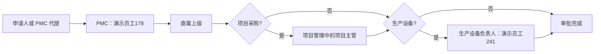
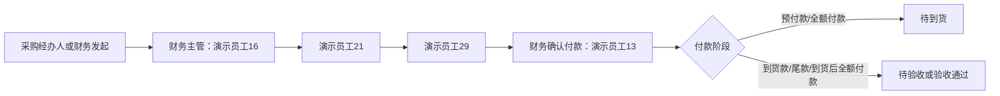

# OA 审批流程 Docker 实施与验证证据

日期：2026-08-18
站点：`rayher.localhost`

## 当前结论

采购申请、购买申请、采购付款、费用付款/报销和请假均接入正式 OA 执行链：提交后生成审批步骤、当前审批人、ToDo、审批日志和业务状态。审批节点按人员账号执行，不使用看板占位数据代替流程。

## 采购申请

- 意向交期始终必填。
- 项目采购必须选择项目，项目主管从项目管理的 `project_owner` 读取并在提交时固化。
- 非项目采购必须选择成本中心、部门或“非项目采购”。
- 同一账号命中直属上级、项目主管等多个角色时按人去重。
- 演示员工178可以为任一在职员工代提采购，单据身份、部门和直属上级取被代提员工；其他员工只能为自己提交。
- 演示员工178作为申请人或代提人时仍保留 PMC 节点，不再因身份重复产生零节点。

合同交期晚于审批后的意向交期时，必须填写原因，并重新经过 PMC、项目主管确认；确认后抄送申请人、采购经办人、PMC、直属上级、项目主管五类人员。

## 购买申请

- 京东购买：人事经理与演示员工21并行会签，两人都通过后完成。
- 其他购买：直属部门主管 → 部门主管上级（演示员工21或演示员工29）。
- 直属主管已经是演示员工21或演示员工29时只审批一次。
- 演示员工21、演示员工29本人没有更高员工主管路线，因此明确阻止使用“员工其他购买”流程，不允许零节点自动完成。
- “演示员工10”仅作为当前岗位人员账号保存，界面和节点显示“人事经理”。

## 采购付款

上述四节点适用于采购付款的预付款、到货款、尾款和到货后全额付款。费用报销不套用该固定路线，而是按申请人关联员工的部门、直属主管、资产类型和管理层规则动态分流。财务审核与财务主管是两个不同职责节点；采购付款的首节点为财务主管演示员工16。

同一供应商多订单合并付款保留为后续自定义功能，当前不自动合并。

## 履约状态与资料

- 到货：未到货、部分到货、全部到货、关闭未交数量。
- 验收：未验收、待验收、验收通过、验收不合格。
- 异常：催办中、供应商退款中、退货中、换货中、供应商退款完成。
- 预付款核销：无需核销、待核销、已核销。
- 终态：已关闭、已退款。

资料门槛：

- 预付款提交：合同或 PO + 付款计划。
- 100% 预付款：另需预计到货日期和风险说明。
- 到货登记：送货单、收料单或入库单。
- 验收登记：验收资料；不合格时必须填写原因并选择退货或换货。
- 供应商退款完成：退款回单。
- 100% 预付款核销：发票 + 验收资料，且已经全部到货并验收通过。
- 无尾款关闭：发票 + 验收资料 + 采购完成报告；100% 预付款还必须先核销。

换货会清零本轮到货数量，允许再次登记到货和再次验收。供应商退款完成后，付款单进入“已退款”，金额台账冲回已付金额并恢复来源可用金额。

审批驳回支持定向返回申请人或已通过的指定节点，并要求填写原因；返回后该节点及后续节点重新执行。

## 费用报销、固定资产与请假

- 费用报销完成审批后业务状态从“待审批”进入“待付款”，财务确认后进入“已付款”。
- 请假审批完成后业务状态进入“已完成”。
- 费用报销的资产类型会映射到 `asset_nature` 和 `fixed_asset_category`，因此固定资产报销进入付款看板的固定资产汇总及类别下钻。
- 生产设备类费用报销实测路线：演示员工13财务审核 → 直属主管 → 演示员工241 → 演示员工16 → 演示员工21 → 演示员工29 → 演示员工13确认付款。

## Docker 实测证据

临时批次 `VERIFY-20260818-C` 完成以下正式接口验证：

- 京东购买由人事经理、演示员工21两个真实账号完成并行会签。
- 其他购买由演示员工16、演示员工29两个真实账号完成两级审批。
- 100% 预付款、部分预付款、尾款、到货后全额付款均由演示员工16 → 演示员工21 → 演示员工29 → 演示员工13逐节点执行。
- 演示员工178为演示员工150代提项目采购，单据归属演示员工150，演示员工178本人完成 PMC，演示员工132完成去重后的直属主管/项目主管审批。
- 100% 预付款完成“首次到货 → 验收不合格 → 换货 → 再次到货 → 再次验收通过”。
- 部分预付款完成“供应商退款中 → 上传退款回单 → 已退款”；台账由已付 60 元、可用 0 元变为已付 0 元、可用 60 元。
- 演示员工150发起固定资产费用报销，7 个真实账号节点全部完成；演示员工150付款看板的固定资产及生产设备分类均能下钻到该单。
- 58 个有启用账号的在职员工完成请假、费用报销、采购申请、其他购买共 232 条账号路由检查；230 条有效，演示员工21、演示员工29本人发起员工其他购买的 2 条按规则被阻止。

测试后精确删除 12 张测试申请、17 份业务资料、40 条待办、9 条金额流水和 18 个测试文件。复查测试申请、测试文件、孤立业务资料、孤立金额流水、孤立 OA 待办均为 0。

## 自动回归

- 后端：89 个测试文件隔离执行，1081 项通过。
- 前端：203 项通过。
- Vite 生产构建：成功。
- Docker `bench --site rayher.localhost migrate`：成功。

后端测试逐文件隔离，是因为部分历史测试会替换全局 Frappe 模块；合并到同一 pytest 进程会产生测试进程级导入污染。

## 本轮实际发现并修复

1. 其他购买对部分管理人员形成零审批节点。
2. 采购付款首节点误用财务审核，已统一为财务主管演示员工16。
3. 京东会签曾按串行语义处理，已改为同一并行会签节点。
4. 演示员工178作为申请人时 PMC 被错误去重。
5. 固定资产费用报销未映射到付款看板字段。
6. 请假、费用报销和购买申请完成后的业务状态未同步。
7. 换货后不能再次到货和验收。
8. 供应商退款缺少完成接口、退款回单和金额冲回。
9. `退款回单` 已在运行时代码中声明但遗漏 DocType Select 选项，Docker 实测时被数据库拒绝；现已补齐元数据和一致性测试。
10. 测试清理未覆盖失败上传留下的孤立文件；现按严格批次文件名前缀一并清理。
11. 已完成或已付款的费用报销曾未写入 `approved_amount`；现审批完成时同步写入，并通过迁移补齐历史有效单据。

## 挂起项

- 金蝶供应商、采购订单、付款凭证和固定资产卡片同步。
- 同一供应商多订单的自动或半自动合并付款。
- 人工异常审批占位流程的最终审批人和返回节点。
- 财务实际付款操作细节、会计凭证及银行回单自动核对。
- 自动提醒、催办和定制化看板的下一阶段优化。

销售部员工演示员工155、演示员工201等记录已存在于员工信息管理，但未绑定可登录账号；当前没有客服部员工记录。未擅自创建或冒用这些账号。
