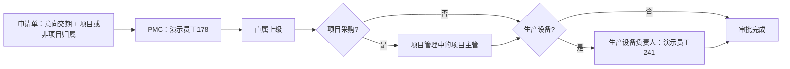
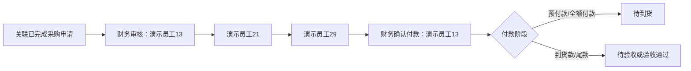

# OA 采购审批流程 Docker 实施与验证证据

日期：2026-08-16  
站点：`rayher.localhost`  
可见测试批次：`OA-DEMO-20260816`

## 结论

采购申请、购买申请、采购付款已接入正式 OA 引擎，不再是看板占位数据。提交后会生成审批步骤、当前审批人、ToDo 待办、审批日志和业务状态。测试数据由正式保存、提交、审批、付款、到货和验收接口产生，并可按批次精确清理。

## 最终流程

### 采购申请

项目主管从项目管理的 `project_owner` 读取并在提交时固化。重复账号按人去重。项目采购必须选择项目；非项目采购必须选择成本中心、部门或“非项目采购”。意向交期始终必填。

### 合同交期闭环

合同交期不晚于意向交期时直接登记；晚于意向交期时，必须填写原因并重新经过 PMC、项目主管确认。确认后抄送 5 个角色：申请人、采购经办人、PMC、直属上级、项目主管。Docker 实测 `OA-2026-00163` 生成 2 个 `contract_delivery` 步骤并完成 5 人抄送。

### 购买申请

- 京东购买：人事经理 → 演示员工21。
- 其他购买：直属上级。
- 表单包含意向交期、所属项目或非项目成本归属、资产属性、购买明细。
- 所有“演示员工10”显示文案改为“人事经理”，账号仍由岗位人员动态解析。

### 采购付款

该固定顺序只适用于采购付款。费用报销/其他购买付款继续按原有部门和人员路由，不被强制套用。

同一供应商付款合并规则暂不自动合并；保留后续自定义合并设计。当前每张付款单必须关联采购申请，金额台账执行占用、付款、释放和余额校验。

## 状态与证据门槛

- 到货：未到货、部分到货、全部到货、关闭未交数量。
- 验收：未验收、待验收、验收通过、验收不合格。
- 异常：催办中、供应商退款中、退货中、换货中。
- 预付款核销：无需核销、待核销、已核销。
- 关闭：已关闭。

证据规则：

- 预付款提交：合同或 PO + 付款计划。
- 100% 预付款：另需预计到货日期和风险说明。
- 到货登记：送货单、收料单或入库单。
- 验收登记：验收资料；不合格时必须填写原因并选择退货或换货。
- 100% 预付款核销：发票 + 验收资料，且到货完成、验收通过。
- 无尾款关闭：发票 + 验收资料 + 采购完成报告；100% 预付款还必须先核销。

## 看板

付款看板新增固定资产、非固定资产、历史未分类及固定资产类别卡片；新增待到货、待验收、验收不合格、待预付款核销、100% 预付款逾期风险卡片。所有卡片都返回单号集合并可下钻到同一批服务端权限范围内的明细。

Docker 测试批次实测：

- 固定资产付款 2 张，金额 100.00。
- 非固定资产付款 2 张，金额 100.00。
- 待到货 1 张。
- 待验收 1 张。
- 验收不合格 1 张。
- 待预付款核销 1 张。
- 100% 预付款逾期 1 张。

## 人员与请假

- PMC：演示员工178，员工 `HR-EMP-90017`，账号 `person076@staff.example.invalid`，角色配置已启用。
- 动态岗位只在“具备启用账号的在职人员”中解析；无账号或停用账号不再造成虚假岗位冲突。
- 请假审批顺序保持原业务逻辑，显示名称改为岗位：演示员工150实测路由为直属主管演示员工132 → 人事经理 → 演示员工21，抄送人事经理与演示员工21。
- 站点原有 `leave_approval_admin_only=1` 功能开关保持不变，本次没有扩大请假模块开放范围。

## 测试数据

可见测试批次 `OA-DEMO-20260816` 共 10 张：

- 采购申请 4 张：项目生产设备、项目非固定资产、非项目电子设备、非项目常规采购。
- 购买申请 2 张：京东固定资产、其他渠道非固定资产。
- 采购付款 4 张：100% 预付款逾期、部分预付款待审批、全额付款待验收、全额付款验收不合格。

测试数据只写入 OA 审批相关单据、步骤、待办、业务资料、文件和金额流水。未新建项目、员工、部门或供应商主数据。供应商当前作为 OA 快照文本保存；供应商主数据/金蝶同步挂起。

清理验证：`OA-E2E-20260816` 先预览匹配 10 张，再精确删除 10 张，复查为 0 张；其他批次不受影响。

## 回归结果

- 后端：86 个测试文件隔离执行，351 项通过。
- 前端：201 项通过。
- Vite 生产构建：成功。
- Docker 迁移：成功。
- 测试前全量站点备份：`20260816_001000-rayher_localhost-*`。

后端全部文件一次性收集会被旧测试中的 `frappe` 假模块污染，出现测试进程级导入冲突；逐文件隔离执行全部通过。这是测试基础设施问题，不是生产逻辑失败。

## 本轮发现并修复的真实缺陷

1. 看板有字段但没有正式提交链路。
2. 采购项目下拉误用项目管理页面权限，普通申请人无法选择项目。
3. 采购提交误用费用报销权限闸门，真实申请人会被拒绝。
4. “出纳”存在一名无账号员工时，被误判为多人岗位冲突。
5. 生产设备类别未加入兼容字段选项，数据库拒绝保存。
6. 采购审批完成后未写批准金额，采购付款无法占用来源余额。
7. 已付款后申请人无法补充到货/验收证据。
8. 合同延期步骤的 `contract_delivery` 来源值未加入字段选项，真实保存失败。
9. 测试清理遇到不可删除流水/业务资料保护；现改为仅对已精确枚举的测试批次做定向清理。

## 挂起项

- 金蝶供应商、采购订单、付款凭证和固定资产卡片同步。
- 同一供应商多订单的自动/半自动合并付款规则。
- 人工异常审批占位流程的最终审批人和返回节点。
- 财务实际付款操作细节、会计凭证及银行回单自动核对。

这些挂起项不阻塞当前 OA 审批、付款风控、到货验收、看板和测试数据链路。
